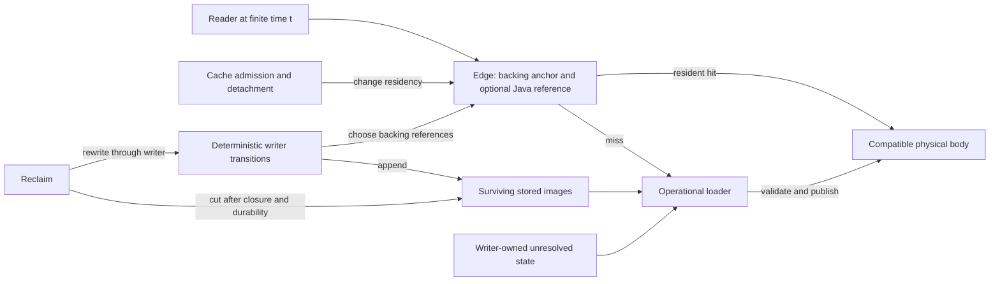

# References, deferred writes, reclaim and caching

011-08. Moved here from `docs/reference-theory.md` on 2026-10-26 (006-07); history, not kept up to date. Its exploratory Lean model, formerly `lean/References/`, is in [08-reference-theory/](08-reference-theory/README.md).

By Codex for Frans Lundberg, 2026-10-14.

**Status, 2026-10-18.** Bergdb item 001 settled the reference rule: Option
K, today's rule (every version names the latest version of every pointee,
live or dead), with no change to the records or the format, proved with
eviction and with reclaim in the Lean model (level4-alignment.md, section 5;
level3-alignment.md, sections 2 and 5). The explicit backing reference
proposed here is in effect the slot's position, which an unswizzle keeps
(INV-SLOT). The text below is the investigation as it was.

Status: theory investigation and proposed direction. This is not an accepted
replacement algorithm, a Java implementation, or a proof that Level 4 works.
Source inspected: BergDB `2e0bfe6`, initially with a clean worktree. The
Level 3 validation work can continue independently. No production Java,
existing SIS proof, storage format or retention policy was changed here.

## 1. Recommended direction

Make the meaning of a reference independent of the cache. Keep an explicit
backing reference beside an optional direct Java reference. Establish which
times that backing reference can serve, and keep unresolved writer state
under writer ownership. Loading and eviction change the physical
representation; only defined writer/reclaim transitions change the
reference that a future record will contain.

This keeps the desired resident read: capture the Java reference once and
follow it. It also gives loading, serialization, eviction and reclaim one
reference contract to preserve. The difficult question then becomes explicit:
how does a writer produce correct, deterministic references when a child
has several stored images and some parents are historical or cold?

The present rule, "serialize the globally latest stored version of every
child, including dead historical edges", deserves reconsideration. It
requires information that an old edge and a bounded recent-write directory
do not always contain. The executable example and small theorem below
establish that limited information problem. They do not prove that every
implementation of the present rule is impossible.

My preferred next candidate is an edge reference that remains fixed once
it is complete for the edge's required historical interval. Current and
unresolved edges need a separately specified writer rule. This could remove
the need to discover irrelevant later child rewrites when an old parent is
written. It changes the abstract reference-selection rule and therefore
needs a new recovery and record-invariance argument before adoption.

Use Lean now for this reference contract and its composition with cuts.
Use executable examples before expanding the proof. Keep ownership policy,
replacement policy and concurrent publication subordinate to that contract.

## 2. What the inspected implementation couples

The following are current source observations, not new defect claims from
whole-database runs:

| Source | Coupling | Design consequence |
|---|---|---|
| `Pointer.getSposForStream()` | A memory reference serializes the target's `getSpos()`; a cold reference serializes the slot's numeric position. | Changing target bodies can change the serialized edge. |
| `KeyNode.pos`, `TopNode.pointersPos` and `rootPointerPos` | A numeric field changes meaning from disk address to access data when swizzled. | The backing reference is lost at the slot; eviction and serialization must reconstruct it. |
| `Cache3.register()` and `makeCanonical()` | A node-ID table prefers canonical bodies or newer snapshots. | A cache preference also influences the writer's choice of body. |
| `NodeCollection.resolvePointers()` | A preferred cached snapshot may replace a child reference before writeout. | Reader cache contents can participate in reference selection. This is the component counterexample in `level4-plan.md`, section 2.1. |
| `NodeCollection.followStreamPointer()` | Rule R redirects by node ID; a key image in the remembered startup section is cut to startup time. | Recovery reconstruction must become an explicit phase, distinct from ordinary reload. |
| `DbHelper.hasDirtyChild()` | The conservative still-dirty test recognizes dirty children through memory references. | Replacing a memory edge by a cold edge must not silently change writer bookkeeping. |
| `Reclaim.step()` | Ordinary reads scan an iteration snapshot, then a writer transaction rewrites old values and touches the index range. | Maintenance reads need bounded admission; rewrite and cut safety must survive a fully cold graph. |

Relevant sources: [Pointer](../../java/src/bergdb/dag/Pointer.java),
[KeyNode](../../java/src/bergdb/dag/KeyNode.java),
[TopNode](../../java/src/bergdb/dag/TopNode.java),
[Cache3](../../java/src/bergdb/core/Cache3.java),
[NodeCollection](../../java/src/bergdb/core/NodeCollection.java),
[DbHelper](../../java/src/bergdb/core/DbHelper.java),
[Db.store](../../java/src/bergdb/core/Db.java),
[Reclaim](../../java/src/bergdb/core/Reclaim.java).

Adding balanced counts and an eviction loop would leave these semantic
couplings in place. That is why the overall reference design comes first.

## 3. Three identities and two graphs

A **logical node ID** identifies one append-only logical history. A
**stored image** is that node's history and references at a particular
stream address. A **physical object** is a Java allocation carrying a
particular history and direct references. Several physical objects and
stored images can belong to the same logical node.

The logical graph at a finite lookup time determines the answer. The
physical graph determines which allocations remain reachable and which
loads are necessary. Physical reachability cannot authorize a disk cut.
Conversely, logical reachability does not require a body to remain in RAM.

One writable canonical body per node ID is a writer requirement. One
physical object per node ID across all historical reads is an unnecessarily
strong requirement: an old image and a current body can legitimately
coexist. The important conditions are completeness for the operation's
time and uniqueness of mutable writer authority.

The current-tree assumption in [sis-model.md](../../docs/sis-model.md), section 11,
is useful: a changed node has one current parent, and the write path finds
its current ancestors. Historical parents still share children. This
assumption must be verified for the Java Dag, including segmented keys,
time/space splits, transient nodes and TopDs. It is not permission to use
single-parent eviction for the whole historical graph.

The proposed roles fit together as follows. The diagram describes the
intended contract, not implemented interfaces or a completed refinement.



## 4. The reference contract

Conceptually, an edge has:

```text
logical target / routing meaning
required lookup-time interval or set
backing reference, possibly unresolved
optional direct reference to a physical body
```

The time requirement need not be an extra stored field. It may follow from
the parent history and routing algorithm. It nevertheless needs a precise
definition. A single entry's time is not automatically the complete interval
for a key range, a segment subtree or a TopDs skip link.

For a completed edge with backing address `a`, the fallback contract is:

```text
For every still-available time at which the query can follow this edge,
the operational loader at a reconstructs the required child state.
```

This is stronger than "the child has been written" and weaker than "a is
the globally newest image of that node". It includes downstream references:
having the right local history is insufficient if a child edge is wrong.

A resident body must serve the same required contexts. A cached immutable
image exactly matching its backing image is the simplest initial case.
Substituting a newer image, promoting a historical image for writing, or
using a dirty canonical body requires an additional argument. Equality of
node IDs and ordering of stream addresses do not supply that argument.

An unresolved edge can point directly to writer-owned state. A virtual
position is not a disk fallback. Dirty/writeout state stays pinned until
the defined write transition supplies a usable backing reference. A dirty
parent may still detach a clean, completely backed child; pinning dirty
ancestors must not retain every clean descendant.

Keep the backing address available while resident. Move replacement hints
out of that field. A first Java representation to evaluate is the existing
direct-reference array beside an address array that always contains
addresses or explicit unresolved references. Prefer node-level/coarse
replacement hints initially. The representation and memory cost require
measurement; this is not a selected Java layout.

```text
resident read: capture targets[i] once; follow the captured object
cold read:     capture/recheck the backing reference; load; validate; publish
eviction:      clear the optional direct reference; preserve its backing meaning
write/reclaim: apply the specified reference transition before publication
```

Separating fields removes the address/access-data confusion. It does not
by itself prove safe publication, array copying or compatibility of a
captured body with the finite lookup time.

## 5. Writer authority must be explicit

Maintain two roles, even if some storage can eventually be shared:

* Writer authority: canonical mutable bodies, dirty membership, transaction
  work, and reconstruction information whose lifetime follows the algorithm.
* Read cache: replaceable bodies that satisfy a declared backing contract.

A read-cache hit cannot decide what version a writer needs. Promotion must
start from the authoritative current path or a proved operational resolver,
establish the full required history, and serialize mutation under writer
exclusion. Keep that work at promotion/loading, away from resident reads.

Dirty membership also needs a semantic contract independent of residency.
If the conservative test remains, it must detect required dirty children
even when a permitted historical edge is cold. A lookup in writer-owned
dirty metadata during writeout is compatible with fast reads. The test's
handling of dead and expired edges must be deterministic and sound; it
cannot depend on whether a reader swizzled a slot.

### 5.1 Why the recent tail is not a complete answer

Consider a historical parent that still carries anchor 100 to node 1.
In history A, node 1's latest image is at 100. In history B it was also
rewritten at 200. Both writes are older than the recent suffix starting at
250. The old parent's anchor and that suffix are identical in A and B.

A resolver using exactly those observations cannot emit the globally latest
address correctly in both histories. A read cache containing image 200
may supply the answer in B, but making its presence authoritative restores
cache-dependent records. Keeping a directory of every latest node position
would supply the information at a cost proportional to total node count.

[Model.lean](08-reference-theory/Model.lean) defines these two write logs,
their observations and latest positions, and proves
`no_latest_from_anchor_and_tail`. This is a theorem about that observation
set. A richer resolver, current-tree search, or an invariant excluding
these states needs its own analysis. These are abstract component histories,
not a demonstration that both complete BergDB execution traces are reachable.

Keeping metadata only while a resident parent needs it also needs a cold
parent argument: a parent can later be loaded from disk. Releasing the
parent does not remove its future serialization obligation.

### 5.2 A reachable case in the existing SIS algorithm

[SISCase.lean](08-reference-theory/SISCase.lean) makes the obligation concrete
in the existing model, with the exact still-dirty test. Its executable
assumption checks pass, and every non-root node has one current parent
in every recorded state. No node changes after it leaves current reachability.

| Record | Transition or observation |
|---|---|
| 0 | Root has parents P and Q beneath it. P points to Y and Z; Q points to E. Initial images are in record 0. |
| 1 | Move Y from P to Q; P replaces that slot with E and remains current through E and Z. Its old edge to Y becomes historical. |
| 2 | Update Y through Q. P is written for the earlier move and retains reference Y@0. Y's update is still deferred. |
| 3 | Y is written at record 3; Q and root acquire its newer reference. P's historical edge remains Y@0. |
| 6 | Y is outside the dirty set and absent from the recent startup suffix; its latest stored image is still Y@3. |
| 7 | Update Z through P. |
| 8 | P is written again. The original `mkVersion` rule selects Y@3 for its dead historical edge, although neither its old anchor nor the recent suffix supplies that address. |

The original model's recovery and restart checks pass for this trace,
including a restart after every transaction. This establishes a real
obligation within the abstract SIS algorithm, beyond an arbitrary pair of
cache objects. It does not establish that the Java B-tree's particular
split/repointing rules permit this exact child move. Such an exclusion
would be a new structure-specific invariant to state and verify.

The current route through Q may provide a richer resolution strategy.
That is information beyond P's historical edge and the suffix. Specify
how to find it by child ID and account for its cost; do not implement the
abstract full-stream `S.lv` as an unbounded ordinary miss operation.

The same file also constructs one alternative record 8 that keeps Y@0.
That image is complete for the sole historical time at which P's edge
to Y is followed in this trace. Recovery from the modified stream still
passes the full finite-view and dirty-set comparison. This supports the
certified-anchor candidate, but is not a new writer algorithm or a proof
of its future transactions. The modified record deliberately differs from
the original algorithm's record.

### 5.3 The reference-rule decision

The existing Lean `SIS.mkVersion` selects `S.lv` for every pointee in the
history, including dead pointers. Merely preserving a historical anchor
does not refine this definition. Query correctness and record equality
are different requirements.

| Candidate | Benefit | Obligation or cost |
|---|---|---|
| Keep globally latest references | Retains the present abstract write rule. | Show how cold historical parents recover the required positions with bounded metadata and acceptable miss cost. |
| Keep certified historical anchors; normalize current/unresolved edges through writer transitions | Avoids discovering later rewrites irrelevant to an edge's required times. | Define closure/binding events, dirtiness, recovery and deterministic serialization; prove the modified algorithm. |
| Copy immutable paths and write them on every change | Makes snapshots and exact references straightforward. | Changes deferred-write scheduling and increases path writeout; requires a separate write-cost comparison. |
| Put a mutable handle at every edge | Centralizes target/version replacement. | Adds a resident dereference and retains an authority-directory/lifetime problem. |

The second candidate is the preferred theory investigation. A possible
rule freezes a closed historical edge once it has a complete backing image,
and updates current or unresolved edges only at specified logical/writeout
events. Splitting copies that semantic reference. Reclaim can replace it
when a required available context needs relocation. An already expired
historical address can remain inert, with identical serialization whether
the slot is warm or cold.

This is a candidate, not a complete transition algorithm. In particular,
an edge can become historical while its child is still dirty. Specify the
dependency retained until a complete image exists and the exact event that
binds the anchor. An arbitrary first read, cache miss, or eviction is not a
deterministic binding event. A child image written while its descendants
are dirty may need reconciliation rather than qualify as a completed image.

This decision may change records relative to the old algorithm. First
retain the existing format layout where possible, but establish
restart/cache invariance for the corrected common writer. Do not claim
byte equality with the old binary. Compatibility of changed record choices
with recovery is a separate gate; no format change is proposed here.

## 6. Reclaim is a change in available reference contexts

Keep four quantities distinct:

| Quantity | Meaning |
|---|---|
| Actual lookup time `t` | The finite snapshot selected for an operation. |
| Retention frontier `r` | Snapshots below this frontier may expire. |
| Physical cut `c` | Backing addresses below this position may disappear. |
| Startup and durable frontiers | Recovery/replay dependencies and bytes whose required persistence has completed. |

Reclaim must establish a closed, recoverable backing graph for every
available lookup context before deleting its old backing. It must also
preserve future writer reconstruction and crash recovery. Correct warm
queries prove none of those cold fallback requirements.

The inspected Level 3 algorithm uses a full scan/touch, completion at
`tEnd/pEnd`, later `pSafe` progress, retention checks and durability checks.
The theory task is to derive the backing-graph property from those
transitions, including deleted-only ranges and long-key subtrees. The
small model proves the consequence of a retained concrete path; it does
not prove that `pSafe` establishes it.

A useful hostile condition is: at a stable operation boundary, discard
every discretionary cached body. All available gets, scans, next writes
and recovery must still be supported by the surviving stream and explicit
writer state. This is a specification experiment, not a proposed routine
whole-cache flush. Production tests must exercise the admitted expiry
contract when boundaries overlap a cut.

Reclaim should read through a maintenance admission policy. Clean scan
objects can be temporary; nodes mutated by its writer transaction receive
ordinary writer ownership. Its work reserve needs to cover actual loaded
and mutated bytes, including oversized values and retained operation
buffers. Read volume, dirty peaks and commit tails matter independently of
the current allowance on writes. This preserves the Level 3 logical policy
while preventing an iteration from populating the entire read cache.

Keep the accepted contract: an admitted operation can expire. Retries
retain its actual finite time, and a scan retains that time across chunks.
A cut does not justify changing a request to a later snapshot. A query may
return a correct warm answer after its time expires, but a cold load must
never publish partially read state or misclassify a failure at an available
time as ordinary expiry.

## 7. Ownership and concurrent publication

Reference meaning and memory release are separate proof obligations.
To release a physical body, all persistent incoming direct references and
writer/root pins must cease to retain it. Historical parent objects count,
including parents absent from the preferred node-ID table. Active traversal
references and reusable operation buffers are additional retention roots.

The JVM manages allocation lifetime. It does not establish canonical
writer identity, permit reading deleted disk bytes, or bound a stalled
reader's retained subgraph. Weak references do not remove strong incoming
edges. Reference counts do not establish correct version selection.

For the first implementation oracle, use writer exclusion and an explicitly
quiescent maintenance boundary. Enumerate physical bodies, detach eligible
edges, and recompute reachability/accounting. This gives a simple reference
behavior against which incremental counts or sweeping can be checked.
It is not a proposal to put an unbounded whole-graph pause in production.

Compare two production lifetime protocols after the reference rule settles:

| Protocol | Simplicity benefit | Remaining cost |
|---|---|---|
| Quiescent maintenance between bounded operations/chunks | Removes simultaneous unswizzling and traversal from the initial concurrency argument; an operation entry/exit cost need not add work per hop. | Maintenance waits for operations, and admitted readers can stall; fairness, I/O, scan chunks, pressure and pause tails require bounds/measurements. |
| Concurrent detachment with retirement and bounded reader protection | Allows traversal to overlap maintenance. | Must prevent publication into retired parents, duplicate writer bodies, self-wait cycles and unlimited retired bytes. |

A quiescent protocol would change the scheduling of cuts/eviction, even
though it can keep expiry between scan chunks. That is an explicit design
alternative, not an already accepted change to Level 3. The existing
concurrent Level 3 tests remain essential.

For either protocol, reader hits capture the reference once. Cold loads
reserve capacity, read outside locks where the protocol permits, then
recheck the parent, backing reference, frontier and publication role. A
miss or capacity wait cannot hold the very reader protection needed for
maintenance to finish. Writers need transaction capacity before partial
mutation; a generic reader-style retry is not a writer rollback protocol.

Separating address and hint fields still requires a Java publication
argument. Plain array element writes and a writer's monitor are not, by
themselves, a happens-before edge to an unsynchronized reader. The current
volatile-size and operation-admission protocol must be audited together
with changes after admission. Specify a synchronized slow path, suitable
publication accesses, or exclusion that supplies the required ordering.
The atomic operations of a sequential Lean model do not supply it.
[Java Language Specification, 17.4 and 17.7](https://docs.oracle.com/javase/specs/jls/se25/html/jls-17.html).

Keep a managed memory target separate from pinned writer state, bounded
operation reserves, retired allocations and storage buffers. Progress must
either release eligible memory or report that required state exceeds the
chosen capacity. Correctness cannot depend on a favorable GC schedule or
on an extra writeout triggered by incidental cache pressure.

## 8. Lean: use it now, with a narrow trusted model

Yes: use Lean to develop the common reference state machine now. A plain
proof sketch can hide exactly the assumptions at issue here: an unlimited
latest-version oracle, a magically correct cold loader, or a cut justified
by resident answers. Formal definitions force those choices into view.

The trusted part remains the definitions and theorem statements. Lean
checks a proposition about the model provided; the relation to the intended
database still requires review. Executable operational definitions are
particularly valuable here: the loader should consume actual anchors,
writer metadata and surviving records, rather than obtain answers from
the logical specification. [Theorem Proving in Lean](https://lean-lang.org/theorem_proving_in_lean4/Introduction/).

Keep the existing SIS model as the logical deferred-write reference. Add
a physical representation and prove refinement. If edge selection changes,
first parameterize/revise the logical write rule and re-establish its
recovery and restart results. The existing T1/T2 proofs cannot simply be
applied to an algorithm with a different `mkVersion`.

Use these proof milestones:

1. **Operational loading and writer promotion.** Define current and
   historical edge contexts, pending bindings and bounded authority. Show
   how concrete state supplies the full required history. Settle the
   globally-latest versus certified-anchor rule here.
2. **Whole traversal.** Prove that following physical references gives the
   logical answer at the admitted finite time. Include shared children,
   distinct images of one node and TopDs/segment routing.
3. **Writes and recovery.** Prove sound dirty tracking and record equality
   across cache schedules, then restart invariance for that writer rule.
   Deterministic bytes remain a serialization refinement obligation.
4. **Reclaim.** Derive cold graph closure from scan/touch/writeout/safety
   progress, then preserve available queries, future writes and recovery
   after cuts. Model permitted expiry explicitly.
5. **Ownership, concurrency and progress.** Prove the selected lifetime
   protocol's atomic state transitions and conditional resource progress;
   check their Java publication/locking refinement separately.

These milestones share one representation invariant. Separate lemmas are
useful; independent models with incompatible meanings of "reference" are
not an overall proof. Include cuts, dirty nodes and historical sharing in
early counterexamples, even while the first proofs cover a smaller domain.

Do not start with a full Java/JMM, filesystem or JVM-collector formalization.
Those remain implementation and platform obligations. Likewise, safety
proofs do not establish throughput, pause limits, or a usable pinned-memory
bound. Lean should help reject or simplify designs before they acquire
production bookkeeping, rather than certify convenient abstractions after
the architecture has already been fixed.

### 8.1 One transition specification to refine

The overall model should use the following transitions and owners. The
unsettled reference-binding rule belongs in writeout/promotion, not in
the physical cache transitions.

| Transition | Owner | Required effect |
|---|---|---|
| Admit | Reader boundary | Fix actual finite time and a suitable published root. Preserve this time across retries/chunks. |
| Load | Cache/loader | Read the declared anchor and explicit authority, reserve temporary space, validate the image/context, then publish a compatible direct reference. Leave logical dirty state and stream records unchanged. |
| Promote | Writer | Establish complete current history and one mutable canonical body before mutation. An arbitrary cached historical body cannot choose the state. |
| Mutate | Writer | Append deterministic logical entries and IDs; mark current ancestors and required dependencies. Preserve earlier snapshots. |
| Writeout | Writer | Follow the fixed startup/writeout policy, write children before parents, bind/normalize references under the chosen rule, and retain unresolved dirty state. Intermediate flag clearing does not permit eviction. |
| Rewrite | Reclaim through writer | Relocate values and touch every required index range, including deleted ranges, without letting read-cache admission affect the chosen records. |
| Advance availability/cut | Reclaim/storage | Establish cold closure for promised contexts, future writers and recovery, and the required durability ordering. Old operations may expire at their original time. |
| Detach | Cache maintenance | Remove only the optional direct reference when its fallback contract holds. Preserve serialized reference meaning and writer bookkeeping. |
| Release | Cache maintenance | End all persistent incoming edges/pins and the selected reader lifetime. Remove the physical body without forgetting required writer/reconstruction authority. |
| Restart | Recovery | Reconstruct the bounded section and rerun deterministic transactions, using an explicit reconstruction phase. Runtime reload subsequently uses the runtime contract. |

For a proof, each transition must preserve the same relation between the
logical histories, concrete edge references, writer-owned dependencies,
surviving images and physical graph. This table specifies the common
obligations; it does not assume a correct promotion or binding algorithm
has already been supplied. The existing SIS trace and new cut/cache
examples expose different parts of that relation.

## 9. The small model implemented in this investigation

[References/Model.lean](08-reference-theory/Model.lean) gives an operational
time-dependent traversal over stored images and a physical heap. A heap
object has its own identity, backing address, image and outgoing direct
references. Different parents can share an object, and different images
can have the same logical node ID. The heap function models object
dereference; it is not a proposed hash-map lookup on Java reader hits.

The all-cold traversal is defined separately. The physical traversal
actually follows its selected object or reads its anchor. It has no access
to a logical answer oracle. Fuel makes arbitrary input graphs executable;
the model reports exhaustion separately from absence and missing backing.
The model does not prove that the BergDB level invariant supplies sufficient
fuel or that its simplified routing implements ordered-key lookup.

The checked results are:

| Lean result | Precise scope |
|---|---|
| `cache_invariance` | For exactly backed immutable images and aligned direct references, an arbitrary physical traversal equals the all-cold traversal at the same time. |
| `detach_preserves_read` | Clearing one optional direct reference preserves that traversal under the same backing/alignment conditions. |
| `detach_preserves_reference` | Clearing a direct reference preserves the explicit serialized anchor. This is a local field property, not T2. |
| `cut_preserves_path` | If every concrete address selected on the time-specific path survives a cut, the all-cold traversal is unchanged. |
| `cache_cut_composition` | Independent pre/post-cut caches satisfying their respective contracts give equal query results for a retained path and fixed time/frontier. |
| `preferred_reference_is_cache_dependent` | The local preferred-cache selector can emit different references when its discretionary entry disappears. |
| `no_latest_from_anchor_and_tail` | The old anchor plus the bounded recent-write observation cannot recover globally latest positions for both constructed write histories. |

`Backed` is deliberately strong: each resident image exactly equals the
image at its backing address. This is the completed immutable-image case.
It excludes dirty canonical bodies and the current loader's discretionary
newer-image substitution. Generalizing it to context-valid bodies must
come with a concrete loader and a refinement proof; an assumed correct
fallback would hide the central problem.

`RetainedPath` describes actual selected disk addresses, but is still a
premise. The model does not establish production reclaim's coverage,
durability or scheduling. `cache_cut_composition` retains the same backing
root: the separate executable relocation example checks one rewritten
root/child pair, without proving arbitrary rewrites.

Missing backing and fuel exhaustion remain explicit results. Equality of
such results is not a proof that every available query succeeds. The next
refinement must derive availability/completeness as well as agreement.

The query boundary rejects a time already below its frontier. That is one
permitted expiry behavior. Interleaved cuts during a Java operation,
writer transactions, retention changes, byte encoding, ownership removal,
capacity bounds, concurrency and restart are outside the new proofs.
This is an initial component model of references and cuts, not the
requested eventual proof that all database operations compose.

[Examples.lean](08-reference-theory/Examples.lean) exercises warm/cold reads,
shared-child detachment, historical/current images, incorrect same-ID
promotion, warm memory masking an invalid cut, valid retained paths,
rewrite-before-cut, expiry, snapshot changes on retry and cache-dependent
reference selection. The bad cases produce the bad result explicitly;
they are negative controls for the proposed invariants.

## 10. Validation and next concrete deliverable

Before Java inspection, the existing SIS sources were copied to
`/private/tmp/bergdb-reference-theory-dk886d1k/lean` for a fresh isolated build.
`lake build` passed all 27 jobs. `lake exe sistest 20 40` passed assumptions,
T1 and T2 for 20/20 seeds in each of eight variants. The four public T1/T2
axiom checks reported only `[propext, Classical.choice, Quot.sound]`.
These reconfirm the existing abstract recovery/restart scope.

The new checker runs the exploratory model and examples in a temporary
directory using the existing pinned Lean toolchain. It leaves the shared
SIS build alone:

```sh
sh lean/References/check.sh
```

To also rebuild the existing SIS proof library in that temporary directory
and check/print the reachable historical-reference trace:

```sh
sh lean/References/check.sh --sis
```

The printed axiom lists for the new traversal, detachment and cut-composition
proofs contain only `propext`; the observation limitation theorem has no
axiom dependencies. There are no admitted proof obligations in these files.
The examples pass. No Java regression or performance claim follows from
this theory-only work.

The next deliverable should be a complete sequential writer/reference
transition specification and executable trace containing: a shared child,
an old cold parent, a current update, deferred child/parent writeout,
eviction, a reclaim rewrite/cut, another write, and a restart. It must show
which authority survives each transition and which references each record
contains. Run the same logical trace with fully resident, fully cold where
eligible, and varied cache schedules.

Resolve that trace and its general loading/reference-selection lemma
before adding production ownership machinery. Then select the smallest
lifetime protocol that meets measured read and maintenance-tail requirements.
The existing [Level 3 validation plan](06-level3-plan.md) remains the integration
gate; its fixed source and performance reference are needed when Java work
begins. [level4-plan.md](05-level4-plan.md) remains an implementation proposal,
to revise after the reference rule and refinement are settled.
